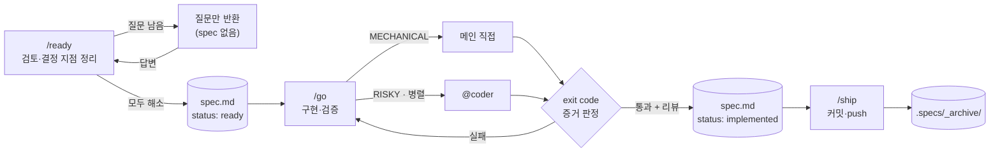

# machina

> *Deus ex machina* — 무대 위 기계 장치(machina)에서 내려와 막힌 이야기를 푸는 신.
> 단, 이 machina는 결말을 마음대로 바꾸지 않는다. **결정은 사용자의 것이다.**

`~/my-dev` 개인 사이드프로젝트(1인 개발)를 위한 Claude Code 하네스.
회사 하네스 agent-docs(my-ringle-orchestrator-v2)의 위임·가드 뼈대와 [dryforge](https://github.com/prekuter/dryforge)의 질문 설계·증거 판정을 결합하고, 팀·외부 시스템 전제는 걷어냈다.

---

## 설계 철학

### 1. 결정은 누구의 것인가
모든 규칙의 출발점. 에이전트의 실패는 대부분 지능이 아니라 **권한** 문제 — 사용자가 정할 것을 짐작으로 채우는 데서 생긴다.
- 제품·도메인 결정 → 사용자에게 **묻는다**
- 기술 결정 → 선택지·트레이드오프·추천을 **제시**하고 사용자가 고른다
- 코드·관례로 이미 정해진 것 → 묻지 않는다

### 2. 추론은 믿되, 자기 채점은 믿지 않는다
"됐다"의 근거는 캡처한 **exit code**와 **실측**(스냅샷·로그·테스트 출력)뿐이다. 평가하지 못한 체크는 통과가 아니라 `미검증 — 사유`. 작성자(메인 세션이든 @coder든)의 자기 평가는 리뷰를 대신하지 못한다.

### 3. 프로즈는 권고, hook은 강제
CLAUDE.md에 쓴 규칙은 지켜질 수도 있고 아닐 수도 있다(회사 하네스 실측 준수율 62%). 그래서 **되돌리기 어려운 사고**(엉뚱한 계정으로 커밋·push, 병렬 세션 커밋 섞임)만 hook으로 기계적으로 막고, 나머지는 스킬에 맡긴다.

### 4. 상시 비용은 최소로
매 세션 컨텍스트에 들어가는 건 CLAUDE.md와 스킬·에이전트 description뿐 — 합계 약 2k 토큰(회사 하네스 약 9k). 무거운 절차는 스킬 본문에 두고 호출할 때만 로드한다. 부작용 있는 스킬은 `disable-model-invocation`으로 description조차 상주시키지 않는다.

### 5. 노력은 위험만큼
명확하고 기계적인 작업은 메인 세션이 직접, 파급이 크거나 병렬 가능한 작업만 @coder에 위임한다. 한두 파일짜리 수정에 ready→go→ship 의식을 강요하지 않는다.

### 6. 멈춤은 허락 요청이 아니라 산출물 경계
`/ready`의 산출물은 spec.md까지다. "좋아요" 같은 승인성 말을 착수 지시로 해석하지 않고, 대안을 요청안 대신 슬쩍 기본안으로 바꾸지 않는다(**기본 진행안 = 요청안**).

### 7. 작게 시작해 실측으로 키운다
쓰이지 않는 규칙은 비용이다. 하네스 lint, 결함 digest, 프로젝트별 CLAUDE.md는 일부러 넣지 않았다 — 실제로 필요해지면 추가한다.

---

## 아키텍처

```
~/my-dev/                       ← machina repo (화이트리스트 .gitignore: 하네스 파일만 추적)
├── CLAUDE.md                   상시 규칙: 원칙 · 위임 규율 · git/계정 · 프로젝트 검증 맵
├── README.md                   이 문서
├── .claude/
│   ├── settings.json           hook 배선 + env(GH_CONFIG_DIR)
│   ├── skills/
│   │   ├── ready/              검토 → spec 박제 → 정지   (+ spec-template.md)
│   │   ├── go/                 spec대로 구현·검증 → 커밋 전 정지
│   │   └── ship/               신원 확인 → 커밋 → push → 보관
│   ├── agents/coder.md         스펙 기반 구현 전담 서브에이전트
│   └── hooks/
│       ├── git-guard.sh        PreToolUse(Bash): 계정·작업장·push 사고 차단
│       └── review-suggest.sh   PostToolUse(Edit|Write): 리뷰 힌트 주입
│
├── claude-pets/                ┐
├── jarvis/                     │ 각자 독립 git repo (machina가 추적하지 않음)
├── logic-pro-mcp/              │ 작업 문서는 <project>/.specs/ — 각 repo .git/info/exclude로 제외
├── PalworldModManager/         │
└── cc-monitor/                 ┘
```

### 레이어별 역할과 비용

| 레이어 | 언제 로드되나 | 맡는 일 |
|---|---|---|
| `CLAUDE.md` | 매 세션 전량 | 원칙·규율처럼 항상 필요한 것만 |
| skill / agent description | 매 세션 | 트리거 매칭의 **유일한 정본** (CLAUDE.md에 키워드 표를 두지 않는다) |
| skill 본문 | 호출 시 | 절차 상세 |
| hook | 0 토큰 | 결정론적 강제 · 신호 주입 |
| spec.md | 작업 단위 | 세션·에이전트 간 인수인계 |
| auto-memory | 세션 간 | 프로젝트 사실·사용자 선호 |

### 작업 흐름



### 세션 시작 위치 (중요)
Claude Code는 `settings.json`(hook·env)을 **세션을 시작한 디렉토리**에서만 읽는다. 스킬·에이전트도 시작 위치에서 repo 루트까지만 찾는다.
→ **세션은 항상 `~/my-dev` 루트에서 시작한다.** 하위 repo에서 시작하면 CLAUDE.md만 적용되고 hook·스킬·에이전트는 빠진다.

---

## 스킬

### `/ready` — 검토 후 spec 박제, 착수 전 정지
모델 자동 호출 가능("검토부터", "바로 시작하지 말고" 등).

1. **대상 확정** — 프로젝트·slug 결정, `.specs/`를 repo 로컬 제외에 등록
2. **영향 범위 탐색** — `파일:라인` 좌표로 정리
3. **요청안 평가** — 대안은 *추가로*만 제안, 기본안은 언제나 요청안
4. **결정 지점 전수** — 구조 / 동작 / 기술 / 계약 네 관점으로 나열하고 각각 분류
   - 이미 정해짐 → 근거 좌표와 함께 기록
   - 사용자 결정 필요 → 질문 후보
   - 해당 없음 → `N/A — 이유`로 기록 (**조용히 버리지 않는다**)
5. **grounds-gate** — 질문 후보는 ① 정확한 위치 ② 이미 다뤄지지 않았다는 적극적 근거 ③ 방치 시 결과, **셋을 모두 댈 수 있을 때만** 묻는다
6. **분기** — 질문이 남으면 spec 없이 질문만, 해소되면 `spec-template.md`대로 박제(각 작업에 `risk`와 검증 명령)
7. **종료 보고 후 정지**

### `/go` — spec대로 구현·검증, 커밋 전 정지
`disable-model-invocation` — `/go`로만 실행.

- **게이트**: spec이 없으면 `/ready`만 돌리고 멈춘다
- **작업장**: 기본은 현재 브랜치(main) 직접. 다른 세션과 겹치면 worktree 제안
- **구현 분기**: spec의 `risk`가 MECHANICAL → 직접 / RISKY·병렬 → @coder (spec 경로·좌표·검증 명령 동봉)
- **검증**: 확인 포인트 명령의 exit code 캡처, 평가 불가는 `미검증`, 실패 수정 후엔 **전체** 재실행
- **리뷰**: 30줄 초과 또는 로직·상태·계약 변경 시 내장 `code-review`
- **보고**: spec `status: implemented` + 결과 기록

### `/ship` — 커밋 → push → 보관
`disable-model-invocation` — `/ship`으로만 실행.

- **프리플라이트**: 커밋 신원이 95hyun인지, staged 목록에 남의 변경이 섞이지 않았는지
- **커밋**: 그 repo의 메시지 스타일을 따르고 사용자 컨펌 후 커밋
- **push**: origin이 95hyun 소유일 때만 `git push origin HEAD` (남의 repo는 사용자 결정)
- **보관**: spec `status: shipped` → `.specs/_archive/<날짜>-<slug>/`

---

## 에이전트

### `@coder` — 스펙 기반 구현 전담 (sonnet, 파급 큰 작업은 opus)
설계 결정을 내리지 않는 손. 핵심은 **조기 반환 프로토콜**:
- 스펙과 코드가 어긋나거나 스펙에 없는 갈림길을 만나면 임의로 정하지 않고 즉시 반환
- 갈림길 확인 탐색은 2~3파일까지, 무관한 항목은 먼저 끝내고 반환(부분 성과 보존)
- 리포트: 변경(`파일:라인`) · 검증(exit code·원문) · 가정 · 미해결 질문 4줄(발견 사실 / 선택지 / 권고 / 재개 시 할 일)
- 커밋·git 쓰기 금지

---

## Hooks

### `git-guard.sh` (PreToolUse · Bash)

| 판정 | 조건 |
|---|---|
| **deny** | 커밋 신원 ≠ `kingmandoo95@gmail.com` |
| **deny** | 세션이 바인딩된 작업장과 같은 repo의 다른 worktree에서 git 쓰기 |
| **deny** | 현재 브랜치와 다른 브랜치를 push |
| **deny** | `gh pr/repo/release/…` 실행 시 활성 gh 계정 ≠ 95hyun |
| ask | push 대상 origin이 95hyun 소유가 아님 (logic-pro-mcp, PalworldModManager 등) |
| ask | force-push · 원격 브랜치 삭제 |
| ask | 다른 세션이 쓰는 작업장에서 checkout / reset --hard / clean / add -A |

- 항상 exit 0, 판단 불가 시 무개입 — 무관한 Bash를 깨뜨리지 않는다
- 탈출구: `GIT_GUARD_REBIND=1`(의도된 작업장 전환), `GIT_GUARD_OK=1`(사용자 승인 하 1회 통과)
- 세션 바인딩 상태: `~/.claude/git-guard/<session_id>.tsv` (24시간 미사용 시 정리)

### `review-suggest.sh` (PostToolUse · Edit|Write|MultiEdit)
코드(`.swift .rs .ts .py …`)나 하네스 파일이 수정되면 "일단락되면 리뷰하라"는 힌트를 **Claude 컨텍스트에만** 주입한다. 사용자 화면 출력 0, 세션당 프로젝트별 1회.

---

## 계정 분리

my-dev는 개인 계정 **95hyun**, 회사 디렉토리(`~/ringle-devel`)는 회사 계정을 쓴다.

| 항목 | 메커니즘 | 범위 |
|---|---|---|
| 커밋 신원 | `~/.gitconfig` → `[includeIf "gitdir:~/my-dev/"]` → `~/.gitconfig-95hyun` | `~/my-dev` 아래 모든 repo (터미널 포함) |
| push SSH 키 | `~/.gitconfig-95hyun`의 `core.sshCommand` (회사 `~/.ssh/config` 차단) | 동일 |
| gh CLI | `settings.json` → `env.GH_CONFIG_DIR=/Users/hyun/.config/gh-95hyun` | `~/my-dev`에서 시작한 Claude 세션 |
| 강제 | `git-guard.sh`가 신원·gh 계정 불일치를 deny | 동일 |

---

## 계보

| 가져온 것 | 출처 |
|---|---|
| head/coder 위임 규율, 조기 반환 프로토콜 | agent-docs |
| git-guard 세션↔작업장 바인딩, PostToolUse 신호 주입 | agent-docs |
| "spec 없으면 go는 ready만", "멈춤 = 산출물 경계", "기본안 = 요청안" | agent-docs |
| description = 트리거 정본, 상시 비용 모델 | agent-docs |
| "결정은 누구의 것인가", grounds-gate, `N/A — 이유` 기록 | dryforge |
| exit code 증거 판정, "평가 못 한 체크는 실패" | dryforge |
| 위험도(risk) 기반 직접/위임 분기, `disable-model-invocation` | dryforge |

| 버린 것 | 이유 |
|---|---|
| Jira·Slack·배포 감시·위키·지표 에이전트 | 팀·외부 시스템 전제 |
| 스택별 리뷰어 6종, 반증 게이트 | 1인 볼륨엔 과함 → 내장 `code-review` |
| 보호 브랜치 규칙 | 1인 개발은 main 직접 커밋이 정상 |
| 투명성 헤더, 버전 4곳 동기화 | 비용 > 가치 |
| dryforge의 고정 `docs/` 7종, worktree 8병렬 웨이브 | 소규모·Swift/Rust 빌드 비용 |
| dryforge의 "호스트 메모리 금지" | auto-memory를 적극 사용 |

---

## 하네스를 바꿀 때
1. 상시 비용부터 따진다 — CLAUDE.md에 넣을 것인가, 스킬 본문인가, hook인가
2. hook은 진짜 사고 위험에만, 항상 fail-open(무관한 호출을 깨지 않게)
3. 스크립트는 `bash -n` 문법 확인 + 가짜 입력으로 시나리오 테스트
4. 이 repo(`~/my-dev`)에 커밋 — 신원은 includeIf가 자동으로 95hyun
