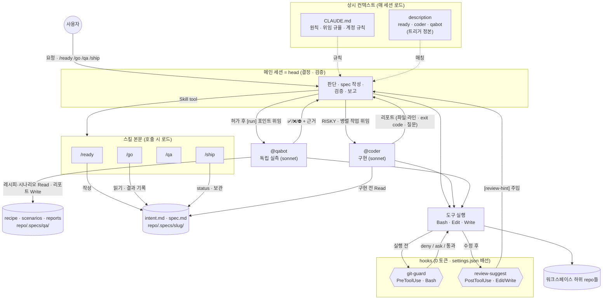
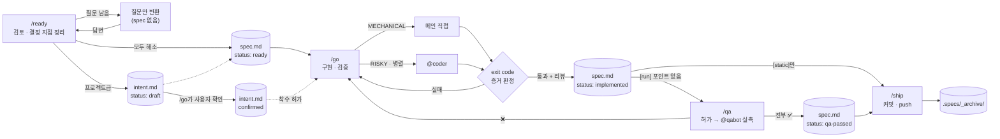

# my-machina

> *Deus ex machina* — 무대 위 기계 장치(machina)에서 내려와 막힌 이야기를 푸는 신.
> 단, my-machina는 결말을 마음대로 바꾸지 않는다. **결정은 사용자의 것이다.**

1인 개발용 Claude Code 하네스. **이 repo를 clone한 디렉토리가 곧 워크스페이스 루트**가 되고, 그 아래에 개인 프로젝트 repo들을 둔다.
회사 하네스 agent-docs(my-ringle-orchestrator-v2)의 위임·가드 뼈대와 [dryforge](https://github.com/prekuter/dryforge)의 질문 설계·증거 판정을 결합하고, 팀·외부 시스템 전제는 걷어냈다.

---

## 설계 철학

### 1. 결정은 누구의 것인가
모든 규칙의 출발점. 에이전트의 실패는 대부분 지능이 아니라 **권한** 문제 — 사용자가 정할 것을 짐작으로 채우는 데서 생긴다.
- 제품·도메인 결정 → 사용자에게 **묻는다**
- 기술 결정 → 선택지·트레이드오프·추천을 **제시**하고 사용자가 고른다
- 코드·관례로 이미 정해진 것 → 묻지 않는다

### 2. 추론은 믿되, 자기 채점은 믿지 않는다
"됐다"의 근거는 캡처한 **exit code**와 **실측**(스냅샷·로그·테스트 출력)뿐이다. 평가하지 못한 체크는 통과가 아니라 `미검증 — 사유`. 작성자(메인 세션이든 @coder든)의 자기 평가는 리뷰를 대신하지 못하고, 실행해 봐야 아는 동작은 코드를 쓰지 않은 @qabot이 실측한다.

### 3. 프로즈는 권고, hook은 강제
CLAUDE.md에 쓴 규칙은 지켜질 수도 있고 아닐 수도 있다(회사 하네스 실측 준수율 62%). 그래서 **되돌리기 어려운 사고**(엉뚱한 계정으로 커밋·push, 병렬 세션 커밋 섞임)만 hook으로 기계적으로 막고, 나머지는 스킬에 맡긴다.

### 4. 상시 비용은 최소로
매 세션 컨텍스트에 들어가는 건 CLAUDE.md와 스킬·에이전트 description뿐 — 합계 약 2k 토큰(회사 하네스 약 9k). 무거운 절차는 스킬 본문에 두고 호출할 때만 로드한다. 부작용 있는 스킬은 `disable-model-invocation`으로 description조차 상주시키지 않는다.

### 5. 노력은 위험만큼
명확하고 기계적인 작업은 메인 세션이 직접, 파급이 크거나 병렬 가능한 작업만 @coder에 위임한다. 한두 파일짜리 수정에 ready→go→qa→ship 의식을 강요하지 않고, qa는 실행해 봐야 아는 확인 포인트가 있을 때만 돈다.

### 6. 멈춤은 허락 요청이 아니라 산출물 경계
`/ready`의 산출물은 intent.md·spec.md까지다. "좋아요" 같은 승인성 말을 착수 지시로 해석하지 않고, 대안을 요청안 대신 슬쩍 기본안으로 바꾸지 않는다(**기본 진행안 = 요청안**).

### 7. 작게 시작해 실측으로 키운다
쓰이지 않는 규칙은 비용이다. 하네스 lint, 결함 digest, 프로젝트별 CLAUDE.md는 일부러 넣지 않았다 — 실제로 필요해지면 추가한다.

---

## 아키텍처

### 런타임 구조

세션 하나 안에서 각 구성요소가 언제 끼어들고 무엇을 주고받는지.



- **판단은 한 곳에서**: 결정·검증은 메인 세션만 한다. @coder는 스펙을 코드로 옮기고, @qabot은 실행·관찰만 한다. 둘 다 갈림길에서 스스로 정하지 않고 리포트로 되돌려 보내며, 메인은 그 리포트를 근거 없이 믿지 않는다.
- **인수인계는 문서로**: 스킬과 서브에이전트는 대화가 아니라 문서로 맥락을 주고받는다 — intent.md는 *왜·무엇*, spec.md는 *어떻게*. 세션이 바뀌어도 이어진다.
- **강제는 hook으로**: git-guard는 메인이든 @coder든 모든 Bash 호출 앞에서 판정한다. 프롬프트 준수에 기대지 않는다.
- **환기는 신호로**: review-suggest는 막지 않고 Claude 컨텍스트에 힌트만 넣는다. 사용자 화면에는 아무것도 뜨지 않는다.

### 작업 흐름



### 레이어별 역할과 비용

| 레이어 | 언제 로드되나 | 맡는 일 |
|---|---|---|
| `CLAUDE.md` | 매 세션 전량 | 원칙·규율처럼 항상 필요한 것만 |
| skill / agent description | 매 세션 | 트리거 매칭의 **유일한 정본** (CLAUDE.md에 키워드 표를 두지 않는다) |
| skill 본문 | 호출 시 | 절차 상세 |
| hook | 0 토큰 | 결정론적 강제 · 신호 주입 |
| intent.md | 프로젝트급 작업 | 왜 하고 무엇이 달라지나 — 범위의 기준선 |
| spec.md | 작업 단위 | 어떻게 할지 — 세션·에이전트 간 인수인계 |
| auto-memory | 세션 간 | 프로젝트 사실·사용자 선호 |

### 파일 구성

```
<workspace>/                    ← 이 repo를 clone한 위치 = 워크스페이스 루트
├── CLAUDE.md
├── README.md
├── .gitignore                  화이트리스트: 하네스 파일만 추적
└── .claude/
    ├── settings.json           hook 배선 + env
    ├── skills/{ready,go,qa,ship}/
    ├── agents/{coder,qabot}.md
    └── hooks/{git-guard,review-suggest}.sh

<workspace>/<project>/          각자 독립 git repo — 이 repo는 추적하지 않는다
<workspace>/<project>/.specs/   작업 문서(intent·spec)와 qa/(recipe·scenarios·reports) — 각 repo의 .git/info/exclude로 제외
```

### 세션 시작 위치 (중요)
Claude Code는 `settings.json`(hook·env)을 **세션을 시작한 디렉토리**에서만 읽는다. 스킬·에이전트도 시작 위치에서 repo 루트까지만 찾는다.
→ **세션은 항상 워크스페이스 루트에서 시작한다.** 하위 repo에서 시작하면 CLAUDE.md만 적용되고 hook·스킬·에이전트는 빠진다.

### intent.md vs spec.md

| | intent.md | spec.md |
|---|---|---|
| 질문 | 왜 하고, 끝나면 무엇이 달라지나 | 어떻게 할 것인가 |
| 언제 | 새 프로젝트 · 제품 재량 큰 기능만 | 비자명한 작업 전부 |
| 섹션 | Problem · Proposed outcome · Non-goals · Constraints · Open questions | 요구사항 · 전제 · 결정 표 · 작업(risk) · 확인 포인트 · 결과 |
| 상태 | draft → confirmed (사용자 확인) | ready → implemented → shipped |
| 위치 | 기능: `.specs/<slug>/intent.md` · 프로젝트 전체: `.specs/intent.md` | `.specs/<slug>/spec.md` |
| 역할 | 범위의 기준선 — 확정 후 Problem·Outcome이 바뀌면 스코프 이탈 신호 | 구현·검증·리뷰의 입력 |

회사 하네스의 intent에서 **Success metric(KPI·baseline)을 빼고 Non-goals를 더했다** — 사이드프로젝트엔 지표 인프라가 없고, 대신 혼자 하다 범위가 불어나는 게 진짜 위험이라서.

---

## 스킬

### `/ready` — 검토 후 intent·spec 박제, 착수 전 정지
모델 자동 호출 가능("검토부터", "바로 시작하지 말고" 등).

1. **대상 확정** — 프로젝트·slug 결정, `.specs/`를 repo 로컬 제외에 등록
2. **영향 범위 탐색** — `파일:라인` 좌표로 정리
3. **요청안 평가** — 대안은 *추가로*만 제안, 기본안은 언제나 요청안
   - **intent 판정** — "무엇을 만들지"가 아직 굳지 않은 작업(새 프로젝트, 여러 세션에 걸치고 제품 재량이 큰 기능)이면 `intent-template.md`대로 intent.md를 `draft`로 먼저 쓴다. 버그 수정·명확한 단건 변경은 면제
4. **결정 지점 전수** — 구조 / 동작 / 기술 / 계약 네 관점으로 나열하고 각각 분류
   - 이미 정해짐 → 근거 좌표와 함께 기록
   - 사용자 결정 필요 → 질문 후보
   - 해당 없음 → `N/A — 이유`로 기록 (**조용히 버리지 않는다**)
5. **grounds-gate** — 질문 후보는 ① 정확한 위치 ② 이미 다뤄지지 않았다는 적극적 근거 ③ 방치 시 결과, **셋을 모두 댈 수 있을 때만** 묻는다
6. **분기** — 질문이 남으면 spec 없이 질문만, 해소되면 `spec-template.md`대로 박제(각 작업에 `risk`와 검증 명령, intent가 있으면 확인 포인트를 Proposed outcome에서 끌어옴)
7. **종료 보고 후 정지**

### `/go` — spec대로 구현·검증, 커밋 전 정지
`disable-model-invocation` — `/go`로만 실행.

- **게이트**: spec이 없으면 `/ready`만 돌리고 멈춘다
- **intent 게이트**: 연결된 intent가 `draft`면 구현하지 않는다 — 남은 질문을 묻고, 요약을 보여준 뒤 사용자 확인을 받아 `confirmed`로 바꾼다
- **작업장**: 기본은 현재 브랜치(main) 직접. 다른 세션과 겹치면 worktree 제안
- **구현 분기**: spec의 `risk`가 MECHANICAL → 직접 / RISKY·병렬 → @coder (spec 경로·좌표·검증 명령 동봉)
- **검증**: `[static]` 확인 포인트 명령의 exit code 캡처, 평가 불가는 `미검증`, 실패 수정 후엔 **전체** 재실행. `[run]` 포인트는 판정하지 않고 `/qa`로 넘긴다
- **리뷰**: 30줄 초과 또는 로직·상태·계약 변경 시 내장 `code-review`. intent가 있으면 Proposed outcome(빠진 것)·Non-goals(넘친 것)와 대조
- **보고**: spec `status: implemented` + 결과 기록

### `/qa` — 런타임·UI 확인 포인트를 독립 실측
`disable-model-invocation` — `/qa`로만 실행. spec의 `[run]` 포인트(실행·화면·외부 앱 상태로만 판정 가능)가 있을 때만 의미가 있다.

- **QA 자산** (`<project>/.specs/qa/`): `recipe.md`(빌드·실행·종료·관찰 수단·실데이터 보호·함정), `scenarios/<영역>.md`(박제 시나리오), `reports/`(qabot 리포트). 첫 QA 때 메인이 recipe 초안을 써서 승인받는다
- **스펙 조립**: `[run]` 포인트 · recipe · 매칭 시나리오 · 실행 영향(띄워 둔 앱 재시작, 실데이터 변경과 원복 방법)
- **허가**: 실행 / 수정 후 실행 / 보류 — 허가 없이는 스폰하지 않는다
- **리포트 불신 검증**: 근거(스냅샷·로그·exit code·MCP 응답) 없는 ✅는 미검증으로 격하, ❌는 원인 확인 후 `/go` 재진입 제안. 전부 ✅면 `status: qa-passed`
- **학습 회수**: 📌 후보를 recipe·시나리오·qabot 함정·findings로 분류해 결과 보고와 같은 턴에 승인 1회로 반영

### `/ship` — 커밋 → push → 보관
`disable-model-invocation` — `/ship`으로만 실행.

- **프리플라이트**: 커밋 신원이 개인 계정인지, staged 목록에 남의 변경이 섞이지 않았는지, `[run]` 포인트가 QA 없이 남지 않았는지
- **커밋**: 그 repo의 메시지 스타일을 따르고 사용자 컨펌 후 커밋
- **push**: origin이 내 계정 소유일 때만 `git push origin HEAD` (남의 repo는 사용자 결정)
- **보관**: spec `status: shipped` → `.specs/_archive/<날짜>-<slug>/`

---

## 에이전트

### `@coder` — 스펙 기반 구현 전담 (sonnet, 파급 큰 작업은 opus)
설계 결정을 내리지 않는 손. 핵심은 **조기 반환 프로토콜**:
- 스펙과 코드가 어긋나거나 스펙에 없는 갈림길을 만나면 임의로 정하지 않고 즉시 반환
- 갈림길 확인 탐색은 2~3파일까지, 무관한 항목은 먼저 끝내고 반환(부분 성과 보존)
- 리포트: 변경(`파일:라인`) · 검증(exit code·원문) · 가정 · 미해결 질문 4줄(발견 사실 / 선택지 / 권고 / 재개 시 할 일)
- intent가 `draft`면 구현하지 않고 반환, intent와 어긋나는 구현은 조기 반환(intent 수정 금지)
- 커밋·git 쓰기 금지

### `@qabot` — QA 실행 전담 (sonnet)
코드를 쓰지 않은 쪽이 실측한다는 원칙의 구현체이자, 스냅샷·로그 같은 무거운 출력을 메인 컨텍스트에서 격리하는 장치.
- 박제 시나리오 우선, 없으면 확인 포인트로 즉석 설계 후 `📌 박제 후보`
- 스펙·recipe에 없는 조작 금지, 사용자 인스턴스·실데이터는 스펙 명시분만 바꾸고 원복 기록
- 소스 수정·소스 Read·git 금지(Edit 도구 없음), Write는 리포트 경로만
- 속도 규약: 서술 턴 금지 · 독립 호출 병렬 · 스크린샷 되읽기 최대 2장 · 포인트당 도구 15회 상한 · 2~3회 막히면 `⛔ BLOCKED + 질문`
- 재현 불가(음성·하드웨어·1초 미만 타이밍)는 시도 없이 `⛔ 미확인(도구 제약)`

---

## Hooks

### `git-guard.sh` (PreToolUse · Bash)

| 판정 | 조건 |
|---|---|
| **deny** | 커밋 신원 ≠ 개인 이메일(`ME_EMAIL`) |
| **deny** | 세션이 바인딩된 작업장과 같은 repo의 다른 worktree에서 git 쓰기 |
| **deny** | 현재 브랜치와 다른 브랜치를 push |
| **deny** | `gh pr/repo/release/…` 실행 시 활성 gh 계정 ≠ 개인 계정(`ME_GH`) |
| ask | push 대상 origin이 내 계정 소유가 아님 (fork·외부 프로젝트) |
| ask | force-push · 원격 브랜치 삭제 |
| ask | 다른 세션이 쓰는 작업장에서 checkout / reset --hard / clean / add -A |

- 항상 exit 0, 판단 불가 시 무개입 — 무관한 Bash를 깨뜨리지 않는다
- 탈출구: `GIT_GUARD_REBIND=1`(의도된 작업장 전환), `GIT_GUARD_OK=1`(사용자 승인 하 1회 통과)
- 세션 바인딩 상태: `~/.claude/git-guard/<session_id>.tsv` (24시간 미사용 시 정리)

### `review-suggest.sh` (PostToolUse · Edit|Write|MultiEdit)
코드(`.swift .rs .ts .py …`)나 하네스 파일이 수정되면 "일단락되면 리뷰하라"는 힌트를 **Claude 컨텍스트에만** 주입한다. 사용자 화면 출력 0, 세션당 프로젝트별 1회.

---

## 설치·설정

### 1. 워크스페이스 루트에 clone
```bash
# 빈 디렉토리라면
git clone git@github.com:95hyun/my-machina.git <workspace>

# 이미 프로젝트 repo들이 있는 디렉토리라면 (화이트리스트 .gitignore라 하위 repo와 충돌 없음)
cd <workspace>
git init && git remote add origin git@github.com:95hyun/my-machina.git
git fetch origin && git checkout -t origin/main
```

### 2. 계정 분리 (회사 계정과 섞이지 않게)
워크스페이스 안에서는 개인 계정, 밖(회사 디렉토리 등)은 기존 계정을 그대로 쓴다.

| 항목 | 설정 | 적용 범위 |
|---|---|---|
| 커밋 신원 · SSH 키 | `~/.gitconfig`에 `[includeIf "gitdir:<workspace>/"]` → 개인 `user.*`·`core.sshCommand`를 담은 별도 파일 | 워크스페이스 아래 모든 repo (터미널 포함) |
| gh CLI | `GH_CONFIG_DIR=<개인 gh 설정 경로> gh auth login` 후 `settings.json`의 `env.GH_CONFIG_DIR`에 같은 경로 | 워크스페이스 루트에서 시작한 Claude 세션 |
| 강제 | `git-guard.sh` 상단의 `ME_EMAIL`·`ME_GH` | 동일 |

> `settings.json`의 `env` 값은 셸이 해석하지 않으므로 `~` 없이 **절대경로**로 쓴다.

### 3. 확인
```bash
git -C <workspace>/<project> config user.email   # 개인 이메일
GH_CONFIG_DIR=<개인 gh 설정 경로> gh auth status   # 개인 계정
```
워크스페이스 루트에서 Claude 세션을 열면 `/ready`가 스킬 목록에 보이고, `/go`·`/qa`·`/ship`은 슬래시로만 실행된다.

---

## 계보

| 가져온 것 | 출처 |
|---|---|
| head/coder 위임 규율, 조기 반환 프로토콜 | agent-docs |
| git-guard 세션↔작업장 바인딩, PostToolUse 신호 주입 | agent-docs |
| "spec 없으면 go는 ready만", "멈춤 = 산출물 경계", "기본안 = 요청안" | agent-docs |
| intent.md draft→confirmed 게이트 (Success metric 제거 · Non-goals 추가로 변형) | agent-docs |
| /qa 위임·허가제·리포트 불신 검증·학습 회수, QA 봇 속도 규약 (Playwright 웹 봇 → 레시피 기반 범용 @qabot으로 변형) | agent-docs |
| description = 트리거 정본, 상시 비용 모델 | agent-docs |
| "결정은 누구의 것인가", grounds-gate, `N/A — 이유` 기록 | dryforge |
| exit code 증거 판정, "평가 못 한 체크는 실패" | dryforge |
| 위험도(risk) 기반 직접/위임 분기, `disable-model-invocation` | dryforge |

| 버린 것 | 이유 |
|---|---|
| Jira·Slack·배포 감시·위키·지표 에이전트 | 팀·외부 시스템 전제 |
| 스택별 리뷰어 6종, 반증 게이트 | 1인 볼륨엔 과함 → 내장 `code-review` |
| QA 환경 표·DB 세팅·로그인 세션·웹 스모크 e2e | 웹 서비스·QA DB 전제 |
| 보호 브랜치 규칙 | 1인 개발은 main 직접 커밋이 정상 |
| 투명성 헤더, 버전 4곳 동기화 | 비용 > 가치 |
| dryforge의 고정 `docs/` 7종, worktree 8병렬 웨이브 | 소규모 프로젝트·네이티브 빌드 비용 |
| dryforge의 "호스트 메모리 금지" | auto-memory를 적극 사용 |

---

## 하네스를 바꿀 때
1. 상시 비용부터 따진다 — CLAUDE.md에 넣을 것인가, 스킬 본문인가, hook인가
2. hook은 진짜 사고 위험에만, 항상 fail-open(무관한 호출을 깨지 않게)
3. 스크립트는 `bash -n` 문법 확인 + 가짜 입력으로 시나리오 테스트
4. 워크스페이스 루트(이 repo)에 커밋
