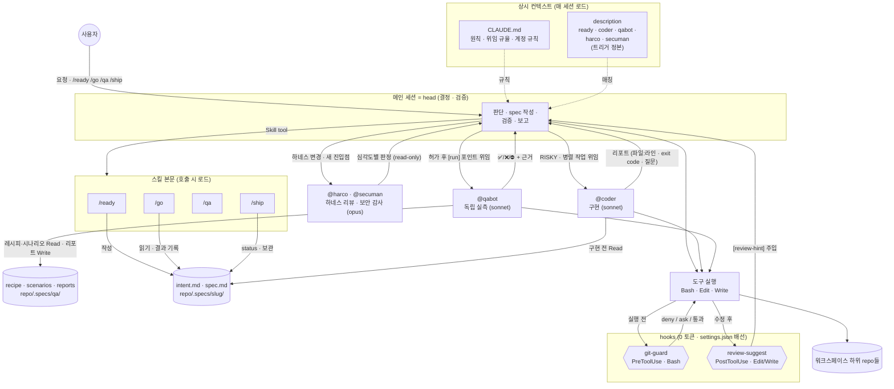
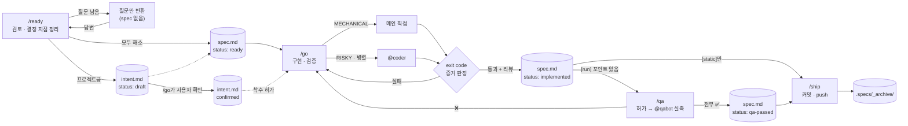

# my-machina

> *Deus ex machina*

1인 개발용 Claude Code 하네스. **이 repo를 clone한 디렉토리가 곧 워크스페이스 루트**가 되고, 그 아래에 개인 프로젝트 repo들을 둔다.
이전에 쓰던 팀 하네스의 위임·가드 뼈대와 [dryforge](https://github.com/prekuter/dryforge)의 질문 설계·증거 판정을 결합하고, 팀·외부 시스템 전제는 걷어냈다.

---

## 설계 철학

### 1. 결정은 누구의 것인가
모든 규칙의 출발점. 에이전트의 실패는 대부분 지능이 아니라 **권한** 문제 — 사용자가 정할 것을 짐작으로 채우는 데서 생긴다.
- 제품·도메인 결정 → 사용자에게 **묻는다**
- 기술 결정 → 선택지·트레이드오프·추천을 **제시**하고 사용자가 고른다
- 코드·관례로 이미 정해진 것 → 묻지 않는다

### 2. 추론은 믿되, 자기 채점은 믿지 않는다
"됐다"의 근거는 캡처한 **exit code**와 **실측**(스냅샷·로그·테스트 출력)뿐이다. 평가하지 못한 체크는 통과가 아니라 `미검증 — 사유`. 작성자(메인 세션이든 @coder든)의 자기 평가는 리뷰를 대신하지 못하고, 실행해 봐야 아는 동작은 코드를 쓰지 않은 @qabot이 실측한다.

### 3. 프로즈는 권고, hook은 강제
CLAUDE.md에 쓴 규칙은 지켜질 수도 있고 아닐 수도 있다(이전 팀 하네스에서 실측한 준수율 62%). 그래서 **되돌리기 어려운 사고**(엉뚱한 계정으로 커밋·push, 병렬 세션 커밋 섞임)만 hook으로 기계적으로 막고, 나머지는 스킬에 맡긴다.

### 4. 상시 비용은 최소로
매 세션 컨텍스트에 들어가는 건 CLAUDE.md와 스킬·에이전트 description뿐 — 합계 약 7KB — 하네스 CI가 예산(`budget.json`)으로 관리한다(이전 팀 하네스는 약 9k 토큰). 무거운 절차는 스킬 본문에 두고 호출할 때만 로드한다. 부작용 있는 스킬은 `disable-model-invocation`으로 description조차 상주시키지 않는다.

### 5. 노력은 위험만큼
명확하고 기계적인 작업은 메인 세션이 직접, 파급이 크거나 병렬 가능한 작업만 @coder에 위임한다. 한두 파일짜리 수정에 ready→go→qa→ship 의식을 강요하지 않고, qa는 실행해 봐야 아는 확인 포인트가 있을 때만 돈다.

### 6. 멈춤은 허락 요청이 아니라 산출물 경계
`/ready`의 산출물은 intent.md·spec.md까지다. "좋아요" 같은 승인성 말을 착수 지시로 해석하지 않고, 대안을 요청안 대신 슬쩍 기본안으로 바꾸지 않는다(**기본 진행안 = 요청안**).

### 7. 작게 시작해 실측으로 키운다
쓰이지 않는 규칙은 비용이다. 하네스 lint, 결함 digest, 프로젝트별 CLAUDE.md는 일부러 넣지 않았다 — 실제로 필요해지면 추가한다.

---

## 아키텍처

### 런타임 구조

세션 하나 안에서 각 구성요소가 언제 끼어들고 무엇을 주고받는지.



- **판단은 한 곳에서**: 결정·검증은 메인 세션만 한다. @coder는 스펙을 코드로 옮기고, @qabot은 실행·관찰만 한다. 둘 다 갈림길에서 스스로 정하지 않고 리포트로 되돌려 보내며, 메인은 그 리포트를 근거 없이 믿지 않는다.
- **인수인계는 문서로**: 스킬과 서브에이전트는 대화가 아니라 문서로 맥락을 주고받는다 — intent.md는 *왜·무엇*, spec.md는 *어떻게*. 세션이 바뀌어도 이어진다.
- **강제는 hook으로**: git-guard는 메인이든 @coder든 모든 Bash 호출 앞에서 판정한다. 프롬프트 준수에 기대지 않는다.
- **환기는 신호로**: review-suggest는 막지 않고 Claude 컨텍스트에 힌트만 넣는다. 사용자 화면에는 아무것도 뜨지 않는다.

### 작업 흐름



### 레이어별 역할과 비용

| 레이어 | 언제 로드되나 | 맡는 일 |
|---|---|---|
| `CLAUDE.md` | 매 세션 전량 | 원칙·규율처럼 항상 필요한 것만 |
| skill / agent description | 매 세션 | 트리거 매칭의 **유일한 정본** (CLAUDE.md에 키워드 표를 두지 않는다) |
| skill 본문 | 호출 시 | 절차 상세 |
| hook | 0 토큰 | 결정론적 강제 · 신호 주입 |
| intent.md | 프로젝트급 작업 | 왜 하고 무엇이 달라지나 — 범위의 기준선 |
| spec.md | 작업 단위 | 어떻게 할지 — 세션·에이전트 간 인수인계 |
| auto-memory | 세션 간 | 프로젝트 사실·사용자 선호 |

### 파일 구성

```
<workspace>/                    ← 이 repo를 clone한 위치 = 워크스페이스 루트
├── CLAUDE.md
├── CLAUDE.local.md             (gitignore) 개인 계정·남의 repo 목록·프로젝트 맵
├── README.md
├── .gitignore                  화이트리스트: 하네스 파일만 추적
└── .claude/
    ├── settings.json           hook 배선 + 워크스페이스에서 끄는 전역 플러그인
    ├── settings.local.json     (gitignore) 개인 env — MACHINA_EMAIL·MACHINA_GH·GH_CONFIG_DIR
    ├── skills/{ready,go,qa,ship,doctor}/          개발 루프 + 클론 진단
    ├── skills/{topic,problem,deepen,mvp,pitch,share}/  해커톤 파이프라인
    ├── agents/{coder,qabot,harco,secuman}.md
    ├── agents/hk-{ideator,scout,researcher,redteam,reviewer}.md  해커톤 전용(스킬만 호출)
    ├── hooks/{git-guard,review-suggest,qabot-guard}.sh
    └── ci/{harness_ci.py,budget.json}   하네스 CI
.github/workflows/harness-ci.yml        push마다 macOS에서 CI
hackathon/{RULES.md,bin/,templates/,runs/}  해커톤 규칙·보조 스크립트·양식, runs/는 산출물(gitignore)

<workspace>/<project>/          각자 독립 git repo — 이 repo는 추적하지 않는다
<workspace>/<project>/.specs/   작업 문서(intent·spec)·findings.md(범위 밖 발견)·defects.md(확정 결함)와 qa/(recipe·scenarios·reports) — 각 repo의 .git/info/exclude로 제외
<workspace>/<project>/docs/decisions.md   결정 이유 — /ship이 spec에서 승격(repo에 커밋)
```

### 세션 시작 위치 (중요)
Claude Code는 `settings.json`(hook·env)을 **세션을 시작한 디렉토리**에서만 읽는다. 스킬·에이전트도 시작 위치에서 repo 루트까지만 찾는다.
→ **세션은 항상 워크스페이스 루트에서 시작한다.** 하위 repo에서 시작하면 CLAUDE.md만 적용되고 hook·스킬·에이전트는 빠진다.

### intent.md vs spec.md

| | intent.md | spec.md |
|---|---|---|
| 질문 | 왜 하고, 끝나면 무엇이 달라지나 | 어떻게 할 것인가 |
| 언제 | 새 프로젝트 · 제품 재량 큰 기능만 | 비자명한 작업 전부 |
| 섹션 | Problem · Proposed outcome · Non-goals · Constraints · Open questions | 요구사항 · 전제 · 결정 표 · 작업(risk) · 확인 포인트 · 결과 |
| 상태 | draft → confirmed (사용자 확인) | ready → implemented → qa-passed → shipped |
| 위치 | 기능: `.specs/<slug>/intent.md` · 프로젝트 전체: `.specs/intent.md` | `.specs/<slug>/spec.md` |
| 역할 | 범위의 기준선 — 확정 후 Problem·Outcome이 바뀌면 스코프 이탈 신호 | 구현·검증·리뷰의 입력 |

이전 팀 하네스의 intent에서 **Success metric(KPI·baseline)을 빼고 Non-goals를 더했다** — 사이드프로젝트엔 지표 인프라가 없고, 대신 혼자 하다 범위가 불어나는 게 진짜 위험이라서.

---

## 스킬

### `/ready` — 검토 후 intent·spec 박제, 착수 전 정지
모델 자동 호출 가능("검토부터", "바로 시작하지 말고" 등).

1. **대상 확정** — 프로젝트·slug 결정, `.specs/`를 repo 로컬 제외에 등록
2. **영향 범위 탐색** — `파일:라인` 좌표로 정리
3. **요청안 평가** — 대안은 *추가로*만 제안, 기본안은 언제나 요청안
   - **intent 판정** — "무엇을 만들지"가 아직 굳지 않은 작업(새 프로젝트, 여러 세션에 걸치고 제품 재량이 큰 기능)이면 `intent-template.md`대로 intent.md를 `draft`로 먼저 쓴다. 버그 수정·명확한 단건 변경은 면제
4. **결정 지점 전수** — 구조 / 동작 / 기술 / 계약 네 관점으로 나열하고 각각 분류
   - 이미 정해짐 → 근거 좌표와 함께 기록
   - 사용자 결정 필요 → 질문 후보
   - 해당 없음 → `N/A — 이유`로 기록 (**조용히 버리지 않는다**)
5. **grounds-gate** — 질문 후보는 ① 정확한 위치 ② 이미 다뤄지지 않았다는 적극적 근거 ③ 방치 시 결과, **셋을 모두 댈 수 있을 때만** 묻는다
   - **독립 추측 탐지** — intent가 있거나 RISKY 작업이 있으면, 대화에 참여하지 않은 읽기 전용 서브에이전트(`guess-hunt.md`)가 근거 없이 정해진 결정과 대화에서 정했는데 spec에서 빠진 결정을 찾는다
6. **분기** — 질문이 남으면 spec 없이 질문만, 해소되면 `spec-template.md`대로 박제(각 작업에 `risk`와 검증 명령, intent가 있으면 확인 포인트를 Proposed outcome에서 끌어옴). 쓴 뒤 요구사항↔작업↔확인 포인트 추적 점검
7. **종료 보고 후 정지**

### `/go` — spec대로 구현·검증, 커밋 전 정지
`disable-model-invocation` — `/go`로만 실행.

- **게이트**: spec이 없으면 `/ready`만 돌리고 멈춘다
- **intent 게이트**: 연결된 intent가 `draft`면 구현하지 않는다 — 남은 질문을 묻고, 요약을 보여준 뒤 사용자 확인을 받아 `confirmed`로 바꾼다
- **작업장**: 기본은 현재 브랜치(main) 직접. 다른 세션과 겹치면 worktree 제안
- **구현 분기**: spec의 `risk`가 MECHANICAL → 직접 / RISKY·병렬 → @coder (spec 경로·좌표·검증 명령 동봉). risk 공란은 RISKY 취급, 리뷰는 보험이지 기준을 낮출 근거가 아니다
- **검증**: `[static]` 확인 포인트 명령의 exit code 캡처, 평가 불가는 `미검증`, 실패 수정 후엔 **전체** 재실행. `[run]` 포인트는 판정하지 않고 `/qa`로 넘긴다
- **리뷰**: 30줄 초과 또는 로직·상태·계약 변경 시 내장 `code-review`. 하네스 변경은 `@harco`, 셸·권한·IPC·민감 데이터·배포 스크립트 변경은 내장 `security-review`(+새 진입점이면 `@secuman`). intent가 있으면 Proposed outcome(빠진 것)·Non-goals(넘친 것)와 대조. 반영한 지적은 `.specs/defects.md`에 1줄
- **보고**: spec `status: implemented` + 결과 기록

### `/qa` — 런타임·UI 확인 포인트를 독립 실측
`disable-model-invocation` — `/qa`로만 실행. spec의 `[run]` 포인트(실행·화면·외부 앱 상태로만 판정 가능)가 있을 때만 의미가 있다.

- **QA 자산** (`<project>/.specs/qa/`): `recipe.md`(빌드·실행·종료·관찰 수단·실데이터 보호·함정), `scenarios/<영역>.md`(박제 시나리오), `reports/`(qabot 리포트). 첫 QA 때 메인이 recipe 초안을 써서 승인받는다
- **스펙 조립**: `[run]` 포인트 · recipe · 매칭 시나리오 · 실행 영향(띄워 둔 앱 재시작, 실데이터 변경과 원복 방법)
- **허가**: 실행 / 수정 후 실행 / 보류 — 허가 없이는 스폰하지 않는다
- **리포트 불신 검증**: 근거(스냅샷·로그·exit code·MCP 응답) 없는 ✅는 미검증으로 격하, ❌는 원인 확인 후 `/go` 재진입 제안. 전부 ✅면 `status: qa-passed`
- **시나리오 매칭**: recipe의 매핑 표(경로 패턴 → 시나리오)와 이번 변경 파일을 대조
- **학습 회수**: 📌 후보를 recipe·시나리오·qabot 함정·defects(QA가 잡은 결함)로 분류해 결과 보고와 같은 턴에 승인 1회로 반영

### `/ship` — 커밋 → push → 보관
`disable-model-invocation` — `/ship`으로만 실행.

- **프리플라이트**: 커밋 신원이 개인 계정인지, staged 목록에 남의 변경이 섞이지 않았는지, `[run]` 포인트가 QA 없이 남지 않았는지
- **결정 승격**: 커밋 전에 spec을 다시 읽고 코드로 알 수 없는 것만 프로젝트로 올린다 — 함정·검증법 → 프로젝트 CLAUDE.md, 결정 이유 → `docs/decisions.md` (남의 repo는 auto-memory, 하네스 자체는 README)
- **커밋**: 그 repo의 메시지 스타일을 따르고 사용자 컨펌 후 커밋
- **push**: origin이 내 계정 소유일 때만 `git push origin HEAD` (남의 repo는 git-guard가 deny, 기여는 사용자 결정)
- **보관**: spec `status: shipped` → `.specs/_archive/<날짜>-<slug>/`
- **결함 환류**: 워크스페이스 `defects.md`에서 같은 실패 메커니즘이 서로 다른 작업 3건 이상이면 `coder.md` "반복 함정"(범용) 또는 프로젝트 CLAUDE.md(고유)에 반영 제안 — 8줄 상한, 8주 재발 0이면 퇴출. cron 없이 ship마다 확인

---

## 에이전트

### `@coder` — 스펙 기반 구현 전담 (sonnet, 파급 큰 작업은 opus)
설계 결정을 내리지 않는 손. 핵심은 **조기 반환 프로토콜**:
- 스펙과 코드가 어긋나거나 스펙에 없는 갈림길을 만나면 임의로 정하지 않고 즉시 반환
- 갈림길 확인 탐색은 2~3파일까지, 무관한 항목은 먼저 끝내고 반환(부분 성과 보존)
- 리포트: 변경(`파일:라인`) · 검증(exit code·원문) · 가정 · 미해결 질문 4줄(발견 사실 / 선택지 / 권고 / 재개 시 할 일)
- intent가 `draft`면 구현하지 않고 반환, intent와 어긋나는 구현은 조기 반환(intent 수정 금지)
- 커밋·git 쓰기 금지

### `@qabot` — QA 실행 전담 (sonnet)
코드를 쓰지 않은 쪽이 실측한다는 원칙의 구현체이자, 스냅샷·로그 같은 무거운 출력을 메인 컨텍스트에서 격리하는 장치.
- 박제 시나리오 우선, 없으면 확인 포인트로 즉석 설계 후 `📌 박제 후보`
- 스펙·recipe에 없는 조작 금지, 사용자 인스턴스·실데이터는 스펙 명시분만 바꾸고 원복 기록
- 소스 수정·소스 Read·git 금지(Edit 도구 없음), Write는 리포트 경로만
- 속도 규약: 서술 턴 금지 · 독립 호출 병렬 · 스크린샷 되읽기 최대 2장 · 포인트당 도구 15회 상한 · 2~3회 막히면 `⛔ BLOCKED + 질문`
- 재현 불가(음성·하드웨어·1초 미만 타이밍)는 시도 없이 `⛔ 미확인(도구 제약)`

### `@harco` — 하네스 리뷰어 (opus, read-only)
두 층으로 리뷰한다. **기계 층**은 하네스 CI(아래 [하네스 CI](#하네스-ci))로 성능 회귀를 숫자로 판정하고, **판단 층**은 하네스가 비대해질 때의 진짜 문제(토큰보다 **이중 체계 충돌과 주의력 희석**)를 본다. 하네스 파일을 고치면 review-suggest hook이 호출을 환기한다.
- 성능 판정: 예산 상향의 정당성 · 테스트 없는 hook 판정 변경(🔴) · 예산 안이라도 상시 비용 증가분의 가치 · 지연 1.2배 이상의 원인
- 🔴 이중 경로·규칙 충돌 · 깨진 참조 · 압축 중 구속력 소실 · hook 배선 불일치 · "hook이 막는다"는 주장의 실제 집행 여부 · 사고 방지 규칙 소실 · 부작용 스킬의 `disable-model-invocation` 누락
- 🟡 네이티브 중복(대체 기능을 이름으로 명시) · 상시 규칙→hook 이관 가능성 · description 라우팅 품질 · CLAUDE.md↔메모리 이중 등재 · 워크스페이스 고정값 누수 · 모델 티어
- 판정 근거는 상시 컨텍스트 비용 모델(CLAUDE.md 전량 > description > 스킬 본문 > hook 0)

### `@secuman` — 보안 감사 (opus, read-only)
웹 OWASP가 아니라 **"내 맥에서 도는 도구"의 위협 모델**. diff 단위는 내장 `security-review`, 전체 감사·위협 모델 점검은 `@secuman`.
- 공격면: hook 입력 JSON·transcript·소켓·MCP 요청·웹뷰 IPC 같은 신뢰 경계를 넘는 입력 / 셸 호출·권한 자동 승인 / `~/.claude` 대화 원문·토큰 / DMG·install 스크립트 / 의존성
- 🔴 명령·경로 인젝션 · 권한 프롬프트 자동 승인의 출처 미검증 · 인증 없는 로컬 IPC · Tauri 권한 과다 · 하드코딩 비밀 · transcript 원문 2차 유출
- 🟡 `~` 파일 권한 · `/tmp` 고정 경로 · 무검증 설치·격리 해제 · MCP 파괴적 도구 무확인 · 로그 내 민감정보 · CVE

---

## Hooks

### `git-guard.sh` (PreToolUse · Bash)

| 판정 | 조건 |
|---|---|
| 판정 | 조건 | 탈출 |
|---|---|---|
| **deny** | (`MACHINA_EMAIL` 설정 시) 커밋 신원 ≠ 그 이메일 — `-c user.email=`·`GIT_AUTHOR_EMAIL=` 위조, `--git-dir`·서브셸 `cd` 경로 포함 | 없음 |
| **deny** | (`MACHINA_GH` 설정 시) `gh pr/repo/release/…` 실행 시 활성 gh 계정 ≠ 그 계정 | 없음 |
| **deny** | 세션이 바인딩된 작업장과 같은 repo의 다른 worktree에서 git 쓰기 | `GIT_GUARD_REBIND=1` |
| **deny** | 현재 브랜치와 다른 브랜치를 push | `GIT_GUARD_OK=1` |
| **deny** | push 대상 origin이 내 계정(`MACHINA_GH`, 없으면 활성 gh 계정) 소유가 아님 (fork·외부 프로젝트). 둘 다 없으면 생략 | `GIT_GUARD_OK=1` |
| ask | force · mirror · all push, 원격 브랜치 삭제(`--delete`·`:ref`) | — |
| ask | 다른 세션이 쓰는 작업장에서 checkout / rebase / reset --hard / clean / restore / stash / branch -D / add -A | — |

- **탈출 토큰은 명령 맨 앞 env 접두로만 유효**하다. 커밋 메시지·인자 속 토큰은 무시한다. 붙이는 건 사용자가 그 명령을 명시 승인한 뒤에만 한다.
- 판정은 따옴표 구간을 지운 사본으로 한다. 그래서 `echo "git push …"` 같은 문자열을 명령으로 오인하지 않는다.
- 항상 exit 0, 판단 불가 시 무개입 — 무관한 Bash를 깨뜨리지 않는다
- 세션 바인딩 상태: `~/.claude/git-guard/<session_id>.tsv` (12시간 미사용 시 정리)

### `review-suggest.sh` (PostToolUse · Edit|Write|MultiEdit)
코드(`.swift .rs .ts .py …`)나 하네스 파일이 수정되면 "일단락되면 리뷰하라"는 힌트를 **Claude 컨텍스트에만** 주입한다. 사용자 화면 출력 0, 세션당 프로젝트별 1회.

### `qabot-guard.sh` (PreToolUse · Write|Edit|MultiEdit)
@qabot의 파일 쓰기를 `<project>/.specs/qa/reports/`로 제한한다(`../` 우회 포함 deny). 서브에이전트 호출에만 hook 입력에 `agent_type`이 실려서 메인 세션·다른 에이전트는 무개입. Bash 리다이렉트 쓰기는 보지 않는다 — 명령 문자열에서 쓰기 대상을 안정적으로 판정할 수 없어 qabot.md의 금지 규칙으로 둔다.

---

## 하네스 CI

하네스 변경이 **하네스 성능을 해치지 않는지** 기계로 판정한다. 같은 스크립트가 로컬(@harco Step 0)과 GitHub Actions(push·PR마다, macOS 러너)에서 돈다.

```bash
python3 .claude/ci/harness_ci.py                 # 전체 검사
python3 .claude/ci/harness_ci.py --base HEAD~1   # + 기준 커밋 대비 변화량
python3 .claude/ci/harness_ci.py --base HEAD --replay   # + 과거 세션 명령 재생 (로컬 전용)
```

하네스 성능은 세 축으로 정의한다.

| 축 | 무엇을 | 어떻게 | 실패 조건 |
|---|---|---|---|
| **상시 컨텍스트** | 매 세션 들어가는 토큰 | CLAUDE.md + 자동 호출 가능한 스킬·에이전트 description 바이트 (`disable-model-invocation` 스킬은 0) | `budget.json` 초과 |
| **hook 지연** | 모든 Bash·Edit 호출에 붙는 시간 | 시나리오별 중앙값 15회, 기준 커밋의 hook을 git 객체에서 꺼내 같은 샌드박스에서 비교 | 예산 초과, 기준 대비 1.5배+20ms 초과 |
| **hook 재생** (`--replay`) | 케이스 표에 없는 회귀 | 이 워크스페이스 과거 세션의 git·gh 명령을 기준 hook과 현재 hook에 같은 순서로 입력(세션별 임시 HOME, 명령은 실행 안 함). transcript가 이 머신에만 있어 Actions에선 생략 | 신규 차단(allow→deny) 1건 이상. 완화는 경고 → @harco 판정 |
| **동작 회귀** | 가드가 막을 걸 막고 통과시킬 걸 통과시키나 | 격리 샌드박스(가짜 HOME·repo·worktree·gh 설정)에서 git-guard·review-suggest·qabot-guard 판정 케이스 + 재생기 자체 검증 + 구조 정합(frontmatter·배선·참조·상태 어휘·고정 경로) | 기대와 다른 판정, fail-open 위반, 정합 위반 |

- 예산은 `.claude/ci/budget.json`. 올리려면 같은 커밋에서 수정하고 사유를 남긴다 — @harco가 상향의 정당성을 따로 판정한다.
- hook 판정 로직을 바꾸면 `harness_ci.py`에 기대 판정 케이스를 같이 추가한다(없으면 @harco가 🔴).
- 표준 라이브러리 python3 + jq·git·bash만 필요하다. 실제 계정·repo·`~/.claude`를 건드리지 않는다.

---

## 설치·설정

### 1. 워크스페이스 루트에 clone
```bash
# 빈 디렉토리라면
git clone <repo-url> <workspace>

# 이미 프로젝트 repo들이 있는 디렉토리라면 (화이트리스트 .gitignore라 하위 repo와 충돌 없음)
cd <workspace>
git init && git remote add origin <repo-url>
git fetch origin && git checkout -t origin/main
```

### 2. 개인 설정 (선택 — gitignore된 로컬 파일)
계정을 여러 개 쓴다면(예: 회사·개인) 워크스페이스 안에서만 특정 계정을 강제할 수 있다. 값을 비워 두면 git-guard의 신원·gh 계정 검사만 꺼지고 나머지 가드는 그대로 동작한다.

`.claude/settings.local.json`:
```json
{
  "env": {
    "MACHINA_EMAIL": "you@example.com",
    "MACHINA_GH": "your-github-id",
    "GH_CONFIG_DIR": "<HOME>/.config/gh-personal"
  }
}
```
> `env` 값은 셸이 해석하지 않으므로 `~`·`<HOME>` 대신 실제 **절대경로**로 쓴다. `GH_CONFIG_DIR`은 `GH_CONFIG_DIR=<경로> gh auth login`으로 만든 별도 gh 설정이다.

| 항목 | 설정 | 적용 범위 |
|---|---|---|
| 커밋 신원 · SSH 키 | `~/.gitconfig`에 `[includeIf "gitdir:<workspace>/"]` → `user.*`·`core.sshCommand`를 담은 별도 파일 | 워크스페이스 아래 모든 repo (터미널 포함) |
| gh CLI | 위 `GH_CONFIG_DIR` | 워크스페이스 루트에서 시작한 Claude 세션 |
| 강제 | 위 `MACHINA_EMAIL`·`MACHINA_GH` → git-guard | 동일 |

`CLAUDE.local.md` (개인 프로젝트 맵 — `/ready`·`/go`가 검증 명령을 여기서 찾는다):
```markdown
## 계정
- 남의 repo: `<repo>`(origin=<owner>) — push 금지

## 프로젝트 맵 (검증 명령 = `/go` 완료 증거)
| 프로젝트 | 스택 | 검증 | 비고 |
|---|---|---|---|
| my-app | Swift/SwiftPM | `swift build && swift test` | |
```

### 3. 쓰지 않는 전역 플러그인 끄기
전역(`~/.claude/settings.json`)에서 켠 플러그인도 이 워크스페이스 세션에서는 `settings.json`의 `enabledPlugins`로 끌 수 있다. 다른 디렉토리 세션에는 영향이 없다. 현재 `claude-seo`를 끈다(이 워크스페이스에선 안 쓴다). 이것만으로 상시 description 약 11.5KB(스킬 26개 + 에이전트 19개)가 빠진다 — machina 전체 상시 비용보다 크다.

### 4. 확인
```bash
git -C <workspace>/<project> config user.email   # MACHINA_EMAIL과 같아야 함
GH_CONFIG_DIR=<GH_CONFIG_DIR 경로> gh auth status   # MACHINA_GH 계정
```
워크스페이스 루트에서 Claude 세션을 열고 `/doctor`로 클론 상태를 진단한다(터미널에선 `bash .claude/skills/doctor/doctor.sh`). ❌ 항목은 함께 출력되는 해결 명령대로 고친다. `/ready`가 스킬 목록에 보이고, `/go`·`/qa`·`/ship`은 슬래시로만 실행된다.

---

## 해커톤 파이프라인
반나절 해커톤 기획용 스킬 묶음. 사람은 회의로 결정하고, 평가·리서치·검증·준비물은 스킬이 만든다. 개발 루프와 같은 워크스페이스 루트 세션에서 돈다.
**항상 `/topic`부터 시작한다.** `hackathon/runs/CURRENT`가 이전 run(리허설 등)을 가리키면 `/topic`이 "이어가기/새로 만들기"를 묻는다 — 대회에서는 "새로 만들기".

| 단계 | 명령 | 사람이 할 일 | 산출물(`hackathon/runs/<run>/`) |
|---|---|---|---|
| 0 | — | `hackathon/templates/input-card.md` 팀 칸·손 시드 채우기(5분) | — |
| 1 | `/topic <run이름>` + 주제 6개 붙여넣기 | 직감 투표 → 주제 확정 | `01-topics.md` |
| 2 | `/problem` | 정찰(근거·경쟁·이기는 틈) 붙은 후보를 점수 없이 2~3개 고르기 | `02-candidates.md` `02-scout-*.md` `02-problems.md` |
| 3 | `/deepen A3 C1` | 최종 1개 확정 | `03-onepager-*.md` `03-redteam.md` `03-compare.md` |
| 4 | `/mvp` | 독립 리뷰 반영·컷·담당 확정 → 개발 시작 | `04-mvp.md` `04-review.md` (세션별 핸드오프 블록 포함) |
| 5 | `/pitch`, `/pitch grill` | 스토리 확정, 모의 질의 | `05-pitch.md` |
| — | `/share` (단계마다 재실행 가능) | 정본 링크·`final.md`를 Discord에 공유 | `final.md`(정본) `share.md`(원본 묶음) |

- 규칙(게이트 앵커링 방지·수치 출처·팀 선정 기준·45분 하드캡)은 `hackathon/RULES.md` — 각 스킬이 시작할 때 읽는다. 해커톤 세션은 `/model opus`로 시작한다(스킬 frontmatter `model: opus`는 호출 턴만 보장).
- 단계 사이에 `/clear` 해도 된다. 스킬은 대화가 아니라 `hackathon/runs/CURRENT`의 파일을 읽고, 산출물이 있으면 게이트부터 이어간다(다시 만들려면 "다시").
- `/mvp` 이후 개발자는 이 워크스페이스에 작업 repo를 만들고, 루트 세션에 핸드오프 블록을 붙여 `/ready`로 시작한다.
- 진행 시간: `hackathon/runs/<run>/timing.log`. 비용: `/cost`.
- WebSearch는 허용, WebFetch는 일부러 허용 목록에서 뺐다 — 리서치가 읽는 외부 페이지의 프롬프트 인젝션이 로컬 개인값을 무승인 fetch로 내보내는 경로를 막기 위해서. 리서치 중 fetch 승인 프롬프트가 뜨면 URL을 보고 승인한다.
- 토큰($500/인): 서브에이전트는 `/problem` hk-ideator 3 + hk-scout 2(sonnet), `/deepen` hk-researcher ≤3(sonnet) + hk-redteam 1(opus), `/mvp` hk-reviewer 1(sonnet). 한 사람만 파이프라인을 돌리고 다른 팀원은 `share.md`를 본다.
- 플랜 B(네트워크·API 장애): `hackathon/templates/`의 입력 카드·루브릭·원페이저 양식을 손으로 채운다. 순서와 게이트는 같다.

---

## 계보

| 가져온 것 | 출처 |
|---|---|
| head/coder 위임 규율, 조기 반환 프로토콜 | 이전 팀 하네스 |
| git-guard 세션↔작업장 바인딩, PostToolUse 신호 주입 | 이전 팀 하네스 |
| "spec 없으면 go는 ready만", "멈춤 = 산출물 경계", "기본안 = 요청안" | 이전 팀 하네스 |
| intent.md draft→confirmed 게이트 (Success metric 제거 · Non-goals 추가로 변형) | 이전 팀 하네스 |
| /qa 위임·허가제·리포트 불신 검증·학습 회수, QA 봇 속도 규약 (Playwright 웹 봇 → 레시피 기반 범용 @qabot으로 변형) | 이전 팀 하네스 |
| @harco 하네스 리뷰어 (버전 동기화·디렉토리 정책 등 회사 전용 항목 제거, **성능 CI 신설**로 확장) | 이전 팀 하네스 |
| 하네스 CI: harness_lint의 기계 점검 + hook 회귀 테스트·상시 컨텍스트/지연 예산 (신규) | 이전 팀 하네스 확장 |
| @secuman 보안 감사 (Rails/Next/RN OWASP → 로컬 네이티브 위협 모델로 재작성) | 이전 팀 하네스 |
| description = 트리거 정본, 상시 비용 모델 | 이전 팀 하네스 |
| "결정은 누구의 것인가", grounds-gate, `N/A — 이유` 기록 | dryforge |
| exit code 증거 판정, "평가 못 한 체크는 실패" | dryforge |
| 위험도(risk) 기반 직접/위임 분기, `disable-model-invocation` | dryforge |
| ship의 결정 승격(spec → 프로젝트 CLAUDE.md·`docs/decisions.md`), ready의 독립 추측·누락 탐지(`guess-hunt.md`), 요구사항↔작업↔확인 포인트 추적, "리뷰는 보험" | dryforge |
| hook 과거 명령 재생(`--replay`, 기준 대비 신규 차단 0), 결함 기록(`.specs/defects.md`) → 반복 함정 환류, QA 경로→시나리오 매핑, 글로만 적힌 제약을 hook으로(qabot 쓰기 경로) | 이전 팀 하네스 (cron·팀 채널 없이 축소) |

| 버린 것 | 이유 |
|---|---|
| Jira·Slack·배포 감시·위키·지표 에이전트 (wikiman·wikibot·wiki-scout·bigman·datacoach·perfscout·tracko·sentryman) | 팀·외부 시스템 전제 |
| appbot · rails-schema-explorer · fig · careerbot | iOS 시뮬·Rails·Figma 전제 / 경력 기록은 개인 하네스 범위 밖 |
| 스택별 리뷰어(beco·neco·appco), 반증 게이트 | 1인 볼륨엔 과함 → 내장 `code-review` |
| QA 환경 표·DB 세팅·로그인 세션·웹 스모크 e2e | 웹 서비스·QA DB 전제 |
| 보호 브랜치 규칙 | 1인 개발은 main 직접 커밋이 정상 |
| 투명성 헤더, 버전 4곳 동기화 | 비용 > 가치 |
| dryforge의 고정 `docs/` 7종, worktree 8병렬 웨이브 | 소규모 프로젝트·네이티브 빌드 비용 |
| dryforge의 "호스트 메모리 금지" | auto-memory를 적극 사용 |
| 상류(이전 팀 하네스) 정기 동기화 스킬 | 공유용 하네스에 특정 상류 의존이 생김 → 1회 이식으로 대체 |

### 결정 기록

#### 2026-10-25 dryforge·이전 팀 하네스 장점 이식
- **hook 재생은 로컬 전용·옵트인**: transcript는 이 머신에만 있고 개인 명령이 담겨 fixture로 커밋할 수 없다. 신규 차단(allow→deny)만 실패로 두고 완화는 경고 — 의도된 오탐 수정까지 막지 않기 위해. 재생은 세션마다 임시 HOME이라 세션 간 바인딩(ask)은 재현하지 않는다.
- **결함 기록은 프로젝트별 `.specs/defects.md`(미추적)**: 공유 번들에 개인 프로젝트 내용이 들어가지 않게. 환류 결과만 범용 문장으로 `coder.md`에 올린다.
- **독립 추측 탐지는 에이전트 정의가 아니라 프롬프트 파일 + Explore**: description 상시 비용 0, 읽기 전용은 도구 구성으로 강제.
- **결정 승격은 커밋 전(ship 0.5)**: 승격 diff가 같은 커밋 컨펌에 들어가야 해서. 기각: auto-memory 단독(다른 머신·에이전트에서 소실), 프로젝트 CLAUDE.md 단독(결정 이유까지 상시 비용).

---

## 하네스를 바꿀 때
1. 상시 비용부터 따진다 — CLAUDE.md에 넣을 것인가, 스킬 본문인가, hook인가
2. hook은 진짜 사고 위험에만, 항상 fail-open(무관한 호출을 깨지 않게)
3. `python3 .claude/ci/harness_ci.py --base HEAD` 통과 — hook 판정을 바꿨으면 케이스부터 추가하고, 로컬에서 `--replay`로 과거 세션 명령을 재생해 새로 막히는 명령이 0건인지 확인(transcript는 이 머신에만 있어 Actions에서는 생략)
4. `@harco` 리뷰 후 워크스페이스 루트(이 repo)에 커밋 — push하면 GitHub Actions가 같은 CI를 다시 돌린다
- 함정: settings가 작업 트리의 hook을 직접 가리키므로 **hook 수정은 커밋 전에도 모든 세션에 즉시 적용**된다. 판정을 바꿨으면 다른 세션을 쓰기 전에 3번(`--replay` 포함)부터.
- 함정: hook 입력의 `agent_type`으로 에이전트를 구별하는 hook(`qabot-guard.sh`)은 내장 에이전트로만 실측됐다. 커스텀 에이전트 이름이 그대로 실리는지는 첫 실사용(qabot의 리포트 밖 Write → deny)으로 확인한다.
